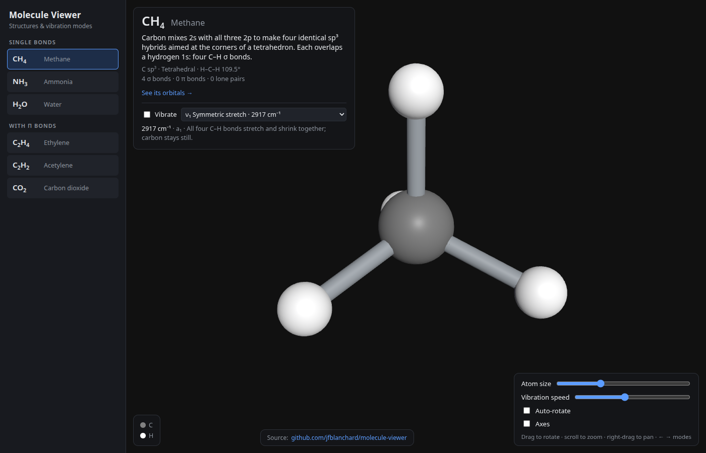
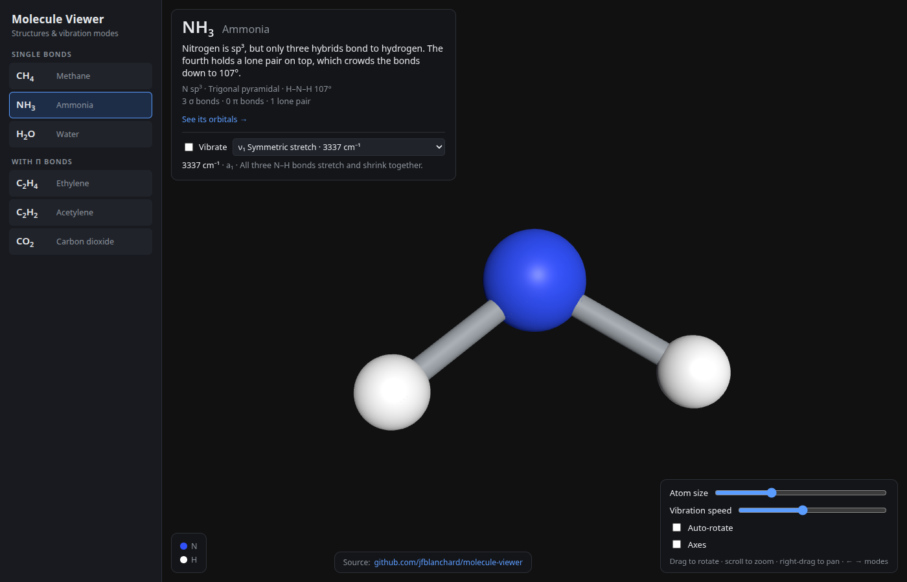
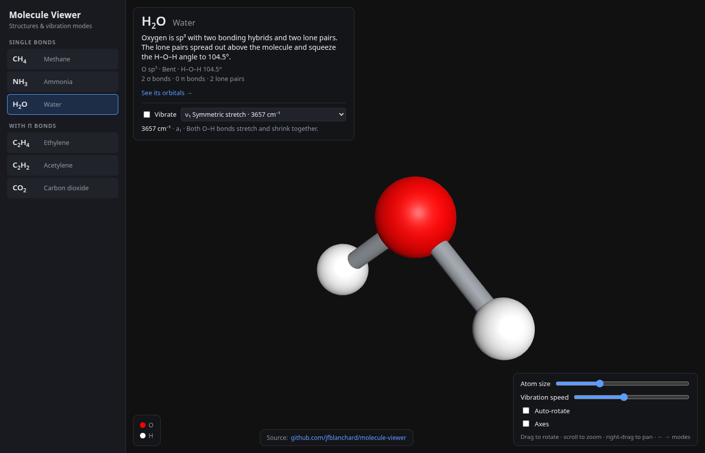
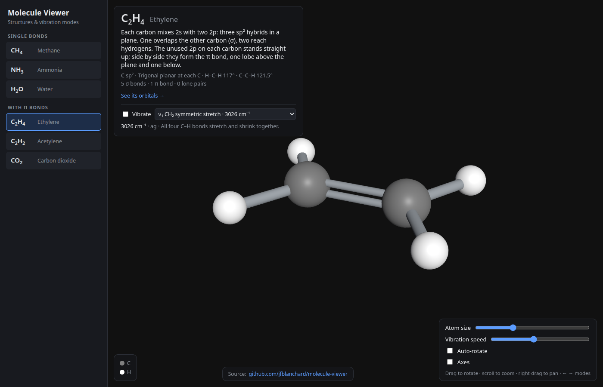
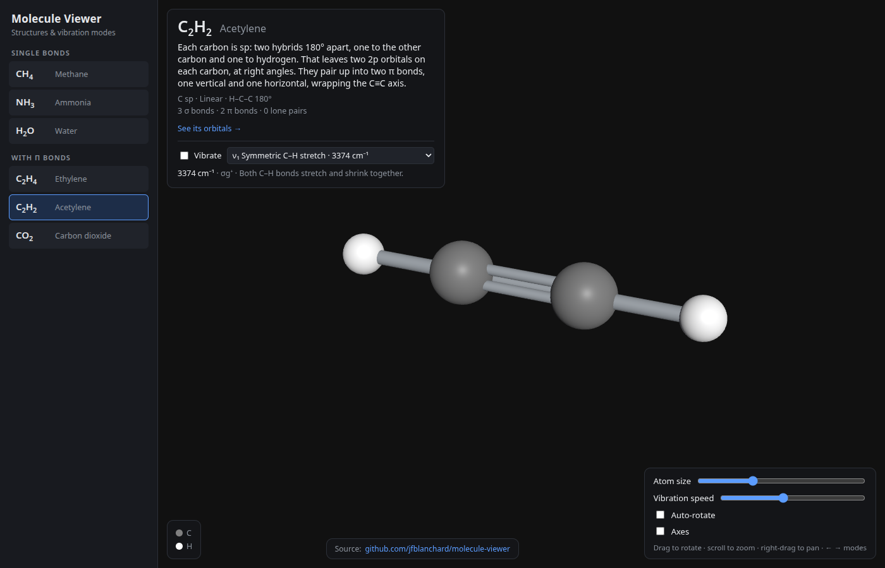
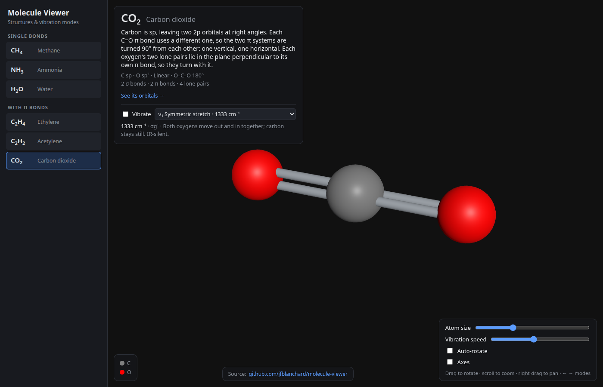

# Molecule Viewer

An interactive 3D viewer of **molecular structures and vibration modes**.
Ball-and-stick molecules at experimental geometry, with computed normal-mode
animations — watch water bend, methane stretch, and acetylene scissor. Part of
a small chemistry visualization suite, alongside the
[Electron Orbital Viewer](https://github.com/jfblanchard/electron-orbital-viewer)
and [Crystal Viewer](https://github.com/jfblanchard/crystal-viewer).


## Try it live

**<https://molecule-viewer.pages.dev>**

## Screenshots

| CH₄ methane | NH₃ ammonia | H₂O water |
|:---:|:---:|:---:|
|  |  |  |
| **C₂H₄ ethylene** | **C₂H₂ acetylene** | **CO₂ carbon dioxide** |
|  |  |  |

## What's included

| Molecule | Hybridization | Shape | Angle |
|---|---|---|---|
| CH₄ | C sp³ | Tetrahedral | H–C–H 109.5° |
| NH₃ | N sp³ | Trigonal pyramidal | H–N–H 107° |
| H₂O | O sp³ | Bent | H–O–H 104.5° |
| C₂H₄ | C sp² | Trigonal planar at each C | H–C–H 117° |
| C₂H₂ | C sp | Linear | H–C–C 180° |
| CO₂ | C sp, O sp² | Linear | O–C–O 180° |

- **Normal-mode vibrations** — pick a mode, animate it, step through with ← →.
- **Adjustable atom size**, axes, and auto-rotate.
- **Deep links**: `#ch4`, `#nh3`, `#h2o`, `#c2h4`, `#c2h2`, `#co2`.
- **Cross-links**: "See its orbitals →" jumps to the same molecule in the
  Electron Orbital Viewer.

## The model

Bond lengths and angles are experimental. Normal modes are computed harmonic
oscillators with their real frequencies and symmetry labels; atoms follow
eq + A·sin(ωt) so a mode's animation is a single shared oscillation.

## Run locally

```bash
cd deploy
python3 -m http.server 8000
# open http://localhost:8000   (a server is required for ES modules)
```

To deploy your own copy to Cloudflare Pages:

```bash
cd deploy
npx wrangler pages deploy . --project-name <your-project-name>
```

## Tests

The geometry and orbital-math test suite lives with the orbital engine in
[`electron-orbital-viewer`](https://github.com/jfblanchard/electron-orbital-viewer):
`node --test tests/` there checks bond lengths and angles against experiment,
hybrid orthonormality, and π-system orientation.

## Layout

```
deploy/   self-contained web app, the deploy unit (see deploy/README.md)
assets/   README screenshots
```

## License / source

Source: <https://github.com/jfblanchard/molecule-viewer>

MIT License (see LICENSE).
